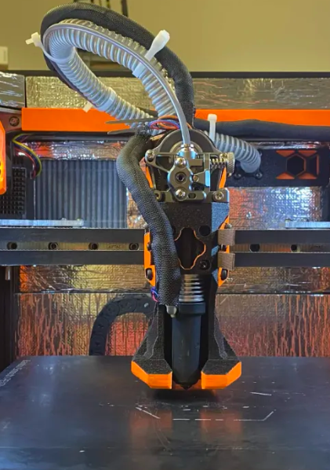
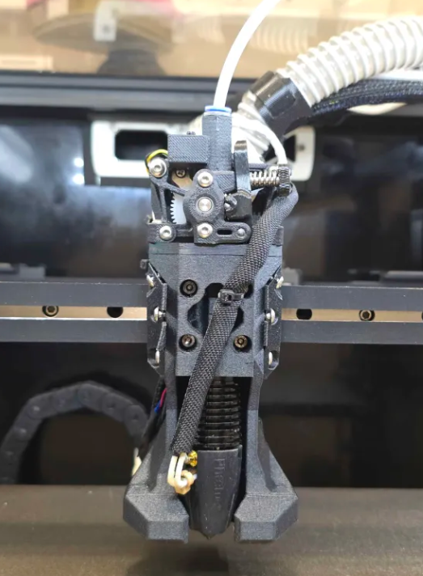
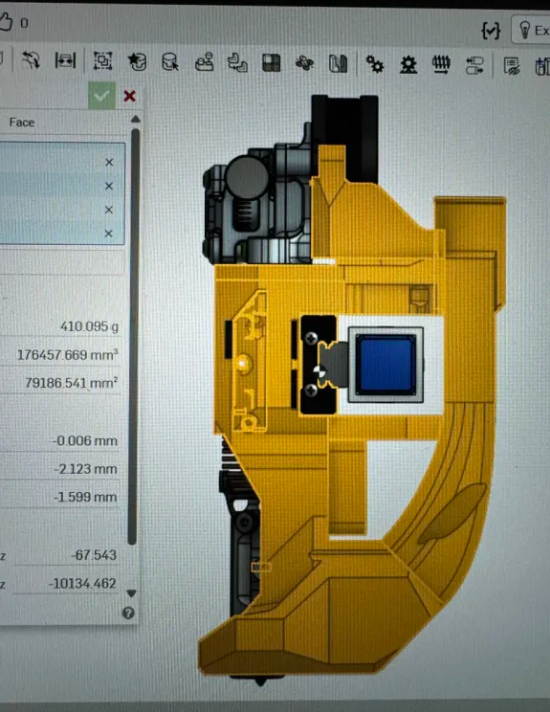

# Sphinx Toolhead

**File repository for the Sphinx toolhead**

Sphinx toolhead is aimed to be a high-performance toolhead with an emphasis on part cooling and rigidity.  
This project was built around the goal of printing a **quality 4-minute PLA Benchy**.  

Sphinx is a **work in progress!** If you have any suggested feel free to reach out of discord!

If you use this toolhead and modify or remix, please upload here or let me know on Instagram or Discord!  
📸 Instagram: [@practically_printed](https://instagram.com/practically_printed)  
💬 Sphinx Development Channel: [sphinx-dev](https://discord.gg/Rgn6Q9szn)

---

---

## 🧩 Notes

The current and most up to date version of Sphinx is called Sphinx tLW. This version utilizes a micro bowden approach in order to optimize for COM while not compromising on toolhead rigidity and so far has proved to work very well. 

- **Print Settings:** 8 walls, 8 top/bottom layers, 40% infill
- Print at least 4 of the Apex clips in either the Voron or Monolith folder

---

## 📸 Pictures (Sphinx tLW)

| | |
|:-----------:|:----------:|
|  |  |

Big thanks to discord users xyglotop and generikv for these images

---

## 📈 Input Shaper Results

| X IS Graph | Y IS Graph |
|:-----------:|:----------:|
|  |  |

---

## ⚙️ Mass Specs / COM

 

 
---

## 🧰 Currently Supported Hardware

**Hotends:**  
- Tricorn
- Goliath
- CHC XL
- RapidoX
- Rapido UHF
- Dragon UHF

**Extruders:**  
- Sherpa Mini  

**Probes:**  
- Beacon
- Cartographer

📋 **Screws, nuts and heat-set inserts:** see the [Hardware BOM](Sphinx%20tLW%20Assemblies%20and%20BOM/BOM.md).

---

## 🔧 Hardware in Progress

**Hotends:**    
- None unless requested    

**Extruders:**  
- Orbiter 2.0   
  

---

## 🌬️ Cooling Capability

The toolhead is built specifically around the duct geometry to maximize usable airflow for part cooling, with support for either WS9290 or WS7040 blowers. The 9290 blower is the optimal option is very aggressive and great for speed printing, but the 7040 duct will not disappoint. The goal of the ducts was to be able to print a perfect 5min benchy. 

## 5min 20sec ABS Benchy

---

## Other Information

Sphinx is meant to be used with an mgn12H rail carriage. A higher preload x rail is encouraged for best Input Shaper results 

COM for this toolhead was optimized using CNC Sherpa Mini and Tricorn, but will also be should be pretty similar with all other hotends

Tested successfully with **Siraya Tech ABS-CF**, though any filled abs or better is recommended.

---

## ☕ Support Sphinx

Want to help support my prototyping and development work? Sphinx has been shaped by testers and feedback from the community. If you'd like to chip in, tips on [Ko-fi](https://ko-fi.com/rileyrandall) help me keep iterating. Never expected, always appreciated.

---

## Acknowledgements

Huge shout out to everyone in the Excit3d and Monolith discord for helping me test and develop this toolhead! Couldn't have done it without their help

---

## 📄 License

Sphinx is released under [Creative Commons Attribution-NonCommercial-ShareAlike 4.0 International](LICENSE) (CC BY-NC-SA 4.0).

- **Attribution** — credit the Sphinx Toolhead Project
- **NonCommercial** — no commercial use or sale without permission
- **ShareAlike** — remixes must be shared under these same terms

This is not an OSI-approved open source license. Please reach out on Discord if you want to discuss commercial use.

*© Sphinx Toolhead Project – Community-driven and free to remix for non-commercial use.*
