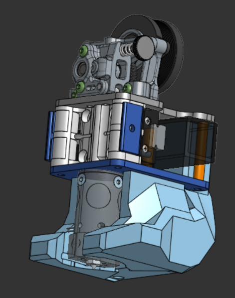
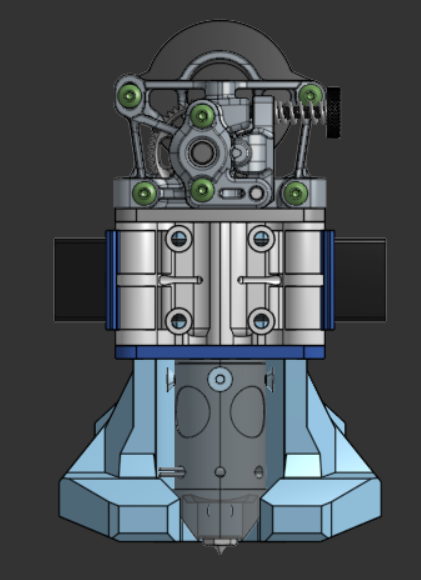
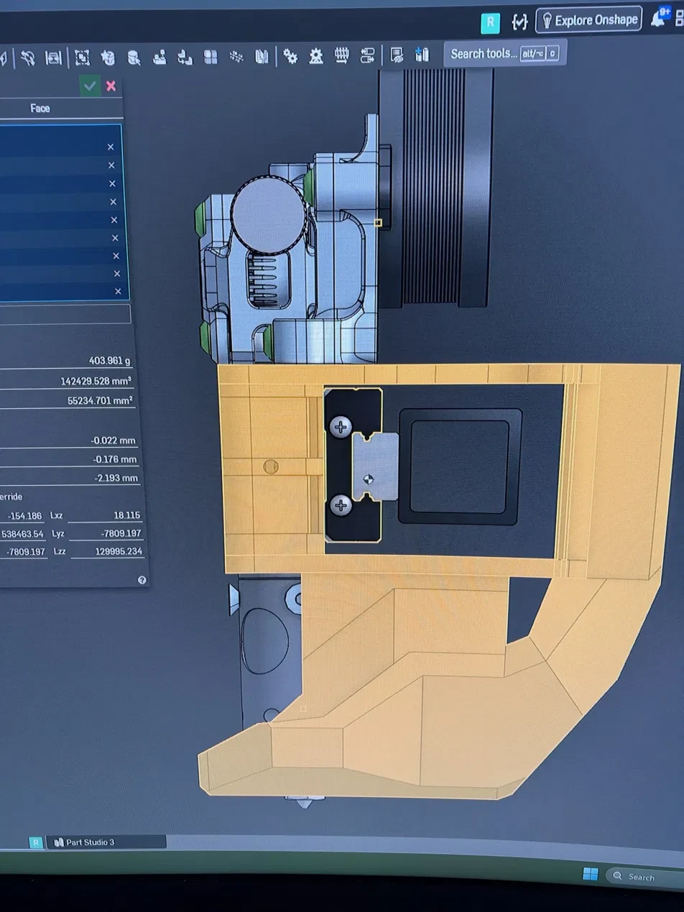

# cnSphinx

A CNC-plate variant of the Sphinx toolhead.

> ⚠️ **Work in progress.** cnSphinx is under active development and has not been finalised. Geometry, hardware compatibility and fitment are all subject to change, and the files here may be revised or replaced without notice. Print, cut or machine at your own risk, and check back for updates before committing to a batch.

---

## 🧩 Design

cnSphinx is built around **two CNC cut plates** that carry the toolhead, paired with a **center housing** available in two forms:

- **SLM** — metal, laser powder bed fusion
- **FDM** — printed, for anyone without SLM access

Both center options drop into the same plate pair, so the choice is yours based on what you can source.
Both use an FDM printed cpap ducts. (Ducts will be uploaded before 11/2026)

---

## ⚙️ Compatibility

**Hotends**
- Chube Compact
- Tricorn Short

**Extruders**
- Sherpa Mini
- Sherpa Heavy

**Probes**
- Beacon
- Cartographer
- Sharto

---

## 📁 Files

Pick the folder matching your carriage.

### `monolith/`

| File | Part |
|---|---|
| `slm_monolith - left_belt_clip.step` | Left belt clip |
| `slm_monolith - right_belt_clip.step` | Right belt clip |
| `slm_monolith_center.step` | Center housing |

### `voron/`

| File | Part |
|---|---|
| `slm_voron - left_clip.step` | Left clip |
| `slm_voron - right_clip.step` | Right clip |
| `slm_voron_center.step` | Center housing |

All files are STEP (AP242), exported from Onshape in millimetre-scale metric units.

---

## 📸 Pictures

### CAD

| Isometric | Front |
|:-----------:|:----------:|
|  |  |

### Center of Mass

---

See the [main README](../README.md) for the wider Sphinx project, print settings and supported hardware.
