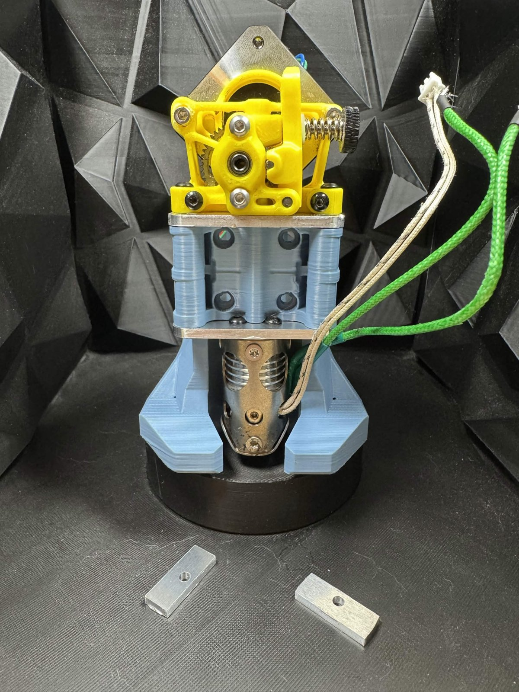
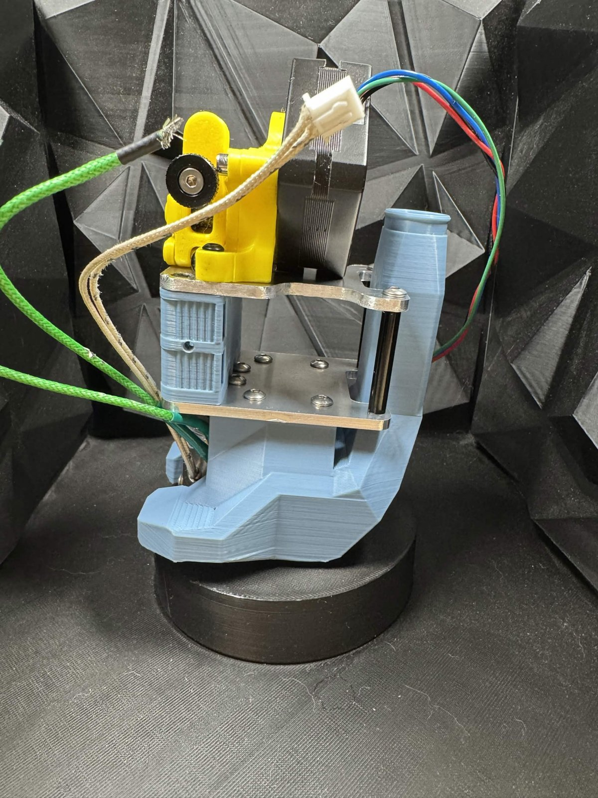

# cnSphinx

A CNC-plate variant of the Sphinx toolhead. Long hotend compatibility coming soon

> ⚠️ **Work in progress.** cnSphinx is under active development and has not been finalised. Geometry, hardware compatibility and fitment are all subject to change, and the files here may be revised or replaced without notice. Print, cut or machine at your own risk, and check back for updates before committing to a batch.

---

## 📸 Prototype Build

| Front | Side |
|:-----------:|:----------:|
|  |  |

☕ Want to help support my prototyping and development work? Sphinx has been shaped by testers and feedback from the community. If you'd like to chip in, tips on [Ko-fi](https://ko-fi.com/rileyrandall) help me keep iterating. Never expected, always appreciated.

---

## 🧩 Design

cnSphinx is built around **two CNC cut plates** — a hotend plate and an extruder plate — that carry the toolhead, paired with a **center housing** available in two forms:

- **SLM** — SLM printed out of aluminum
- **FDM** — printed, for anyone without SLM access

Both center options drop into the same plate pair, so the choice is yours based on what you can source.
Both use FDM printed cpap ducts. Ducts for both supported hotends are in `common/`.

---

## ⚙️ Compatibility

**Hotends** - designed for both hotends to run in conduction
- Chube Compact
- Tricorn Short

**Extruders**
- Sherpa Mini
- Sherpa Heavy

**Probes**
- Beacon
- Cartographer
- Sharto

---

## 🔩 Hardware

- **2 × M3×30 standoffs (through hole)** — required

---

## 📁 Files

Everything in `common/` is required regardless of carriage. After that, pick the folder matching yours.

### `common/`

| File | Part |
|---|---|
| `hotend_plate.step` | Hotend plate — CNC cut |
| `extruder_plate.step` | Extruder plate — CNC cut |
| `tricornShort_duct.step` | CPAP duct, Tricorn Short — FDM printed |
| `chubeCompact_duct.step` | CPAP duct, Chube Compact — FDM printed |

### `monolith/` (Carbonara Friendly)

| File | Part |
|---|---|
| `slm_monolith - left_belt_clip.step` | Left belt clip |
| `slm_monolith - right_belt_clip.step` | Right belt clip |
| `slm_monolith_center.step` | Center housing — SLM |
| `fdm_monolith_center.step` | Center housing — FDM |

### `voron/`

| File | Part |
|---|---|
| `slm_voron - left_clip.step` | Left clip |
| `slm_voron - right_clip.step` | Right clip |
| `slm_voron_center.step` | Center housing — SLM |
| `fdm_voron_center.step` | Center housing — FDM |

All files are STEP (AP242), exported from Onshape in millimetre-scale metric units.

---

## 📸 Pictures

### CAD

| Isometric | Front |
|:-----------:|:----------:|
|  |  |

### Center of Mass

---

See the [main README](../README.md) for the wider Sphinx project, print settings and supported hardware.
